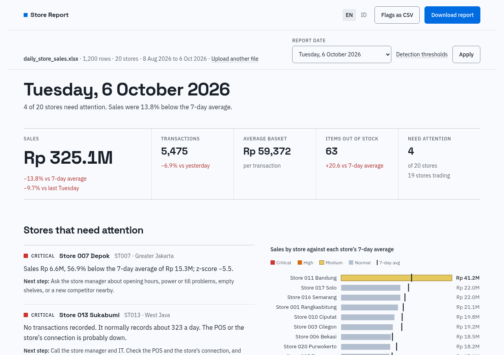
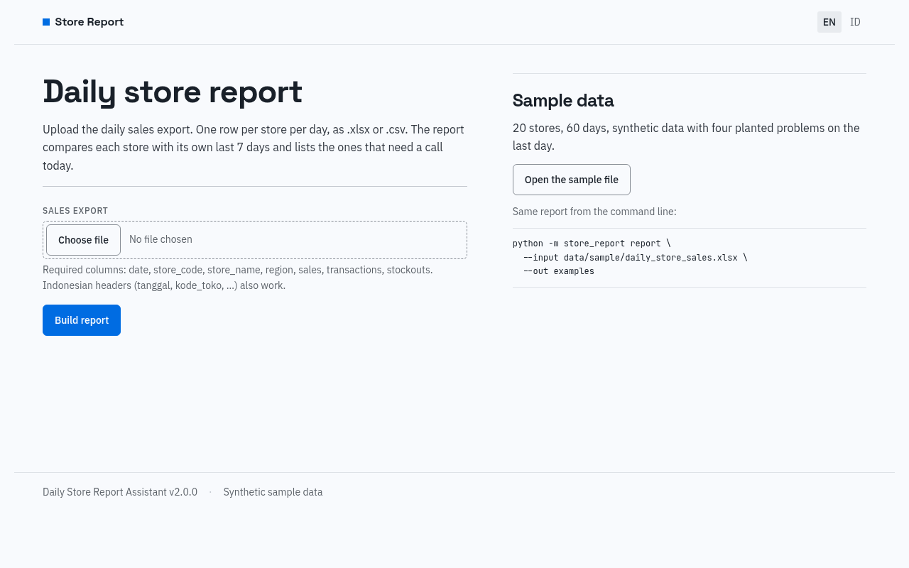
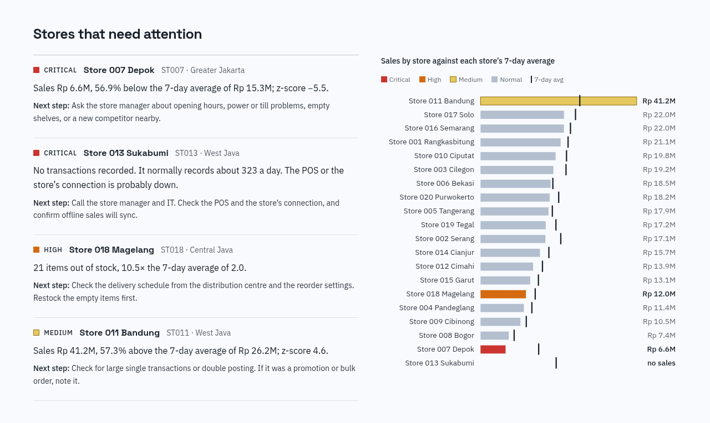
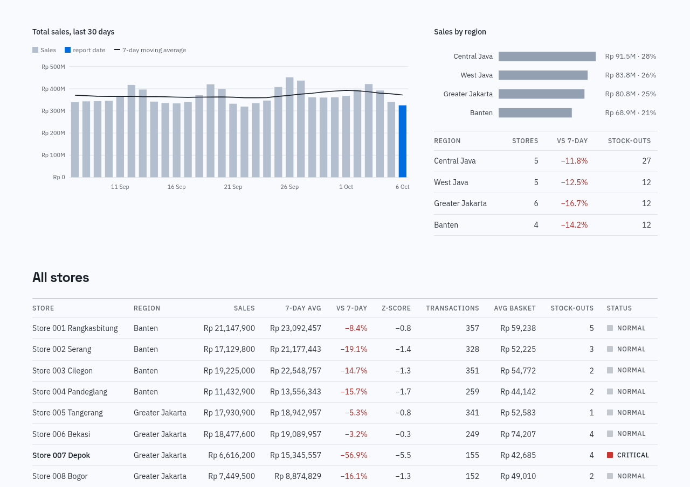
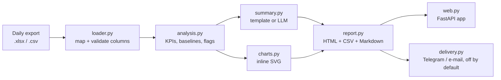

# Daily Store Report Assistant

Turns a daily sales export from a chain of retail stores into a one-page report:
totals, a list of the stores someone should check today, and a short written
summary. Runs as a command, a scheduled job, or a small web app.

All data in this repository is synthetic, produced by
`store_report/data_generator.py`. Store names like "Store 007 Depok" are
placeholders; no real company or store data is used.



## The problem

A minimarket network sends head office one export a day: one row per store,
with sales, transactions and stock-outs. Someone copies it into a spreadsheet,
compares it with previous days, looks for odd numbers and writes an update for
area managers. It takes time every morning, and the things that matter (a till
that was offline all day, a store whose sales halved, a sudden run of empty
shelves) are easy to miss in a table of 20 or more rows.

## What it does

1. Reads the export (`.xlsx` or `.csv`). Column names can be English
   (`date, store_code, store_name, region, sales, transactions, stockouts`) or
   the older Indonesian ones (`tanggal, kode_toko, nama_toko, wilayah, penjualan,
   jumlah_transaksi, jumlah_stockout`); they are mapped automatically.
2. Works out totals per store, per region and overall, compared with yesterday,
   the 7-day average and the same weekday last week.
3. Compares every store with its own recent history, so a small store is not
   flagged just for being small:

   | Rule | Severity |
   |---|---|
   | No transactions for the day | Critical |
   | Store missing from the file but present on earlier days | Critical |
   | Sales 25% or more below its 7-day average (50% or more is critical) | High |
   | z-score of −3 or lower against the last 14 days | Medium |
   | Sales 50% or more above the 7-day average, or z-score +3 or higher | Medium |
   | Stock-outs at least 2× the 7-day average and up by 5 items or more | High |

   Days with zero transactions are left out of the baseline, so one outage does
   not distort the following week. Every flag says why it fired and suggests a
   next step.
4. Writes a summary. Without an API key it uses a plain template. With an
   OpenAI or Gemini key it asks the model to rewrite the same facts, and falls
   back to the template if the request fails.
5. Saves a self-contained HTML report (inline CSS and SVG charts, no
   JavaScript), the flags as CSV and the summary as Markdown.
6. Can send the summary and report by Telegram or e-mail. This is off unless
   `DELIVERY_ENABLED=true` is set; otherwise it prints what it would send.

English is the default. Set `STORE_REPORT_LANG=id`, pass `--lang id`, or use
the EN/ID switch in the web app for Indonesian.

On the sample data it flags exactly the four problems planted on the last day:
Store 013 with no transactions, Store 007 at 57% below its average, Store 018
with 21 items out of stock against a usual 2, and Store 011 at 57% above its
average.

## Screenshots

| | |
|---|---|
|  |  |
| Upload page | Flagged stores with reasons and next steps |
|  |  |
| Report view with KPI strip | 30-day trend, regions, all stores |

A full example report is in [`examples/daily_report_2026-10-06.html`](examples/daily_report_2026-10-06.html)
(Indonesian: [`_id.html`](examples/daily_report_2026-10-06_id.html)).

## How it fits together



## Run it

Python 3.11 or newer.

```bash
python -m venv .venv && source .venv/bin/activate
pip install -r requirements.txt

# 1. synthetic sample data (20 stores x 60 days, four planted problems)
python -m store_report generate --out data/sample --end-date 2026-10-06

# 2. report from the command line
python -m store_report report --input data/sample/daily_store_sales.xlsx --out output
python -m store_report report --input data/sample/daily_store_sales.xlsx --out output --lang id

# 3. web app at http://127.0.0.1:8000
python -m store_report serve

# tests
python -m pytest
```

Useful options for `report`: `--date YYYY-MM-DD`, `--drop-pct 0.25`, `--z 3`,
`--no-llm`, `--send` (still a dry run unless delivery is enabled).

## Configuration

Copy `.env.example` to `.env`. Everything is optional.

| Variable | Purpose |
|---|---|
| `OPENAI_API_KEY`, `OPENAI_MODEL`, `OPENAI_BASE_URL` | Use an OpenAI-compatible model for the summary (default `gpt-4o-mini`) |
| `GEMINI_API_KEY`, `GEMINI_MODEL` | Use Gemini instead (default `gemini-2.5-flash`) |
| `STORE_REPORT_DISABLE_LLM=1` | Always use the template |
| `STORE_REPORT_LANG` | `en` (default) or `id` |
| `DELIVERY_ENABLED` | `true` to actually send; anything else is a dry run |
| `TELEGRAM_BOT_TOKEN`, `TELEGRAM_CHAT_ID` | Telegram delivery |
| `SMTP_HOST`, `SMTP_PORT`, `SMTP_USER`, `SMTP_PASSWORD`, `EMAIL_FROM`, `EMAIL_TO` | E-mail delivery |

## Scheduling

- `.github/workflows/tests.yml` runs the tests on every push.
- `.github/workflows/daily-report.yml` builds a report at 06:00 Jakarta time
  and keeps it as a build artifact. It generates demo data; replace that step
  with whatever fetches your real export.
- `scripts/cron.example` shows the same thing as a Linux cron line.

## Tech

Python, pandas, openpyxl, Jinja2, FastAPI with server-rendered HTML, inline
SVG charts, pytest, GitHub Actions. The LLM calls use the standard library
(`urllib`), so there is no vendor SDK to install. The interface follows the
[Hallmark](https://github.com/nutlope/hallmark) design rules; the system is
written down in [`design.md`](design.md).

## Project layout

```
store_report/
  data_generator.py   synthetic data with planted problems
  loader.py           read .xlsx/.csv, map English or Indonesian headers
  analysis.py         KPIs, baselines, flag rules
  summary.py          template summary, optional OpenAI/Gemini
  charts.py           SVG charts
  report.py           HTML/CSV/Markdown output
  web.py              FastAPI app
  delivery.py         Telegram/e-mail (off by default)
  i18n.py             English and Indonesian text and number formats
  templates/          Jinja templates, tokens.css, styles.css
tests/                37 tests, no network
examples/             generated sample reports
scripts/              screenshot capture, cron example
```

## Limitations

- Tested only on synthetic data. Real exports will have their own quirks
  (returns, partial days, store openings and closures) that need handling.
- The thresholds are fixed rules, not a trained model. They need tuning per
  network, and a store that changes slowly over weeks will not be flagged.
- The OpenAI and Gemini paths are covered by mocked tests only; they have not
  been run against the live APIs in this repository.
- The web app keeps uploads in memory (last 20 files) and has no login. It is
  a demo, not something to expose on the internet as is.
- Fonts load from Google Fonts; offline, the report falls back to system fonts.
- Telegram and e-mail sending is implemented but has not been exercised against
  real accounts here.

## Bahasa Indonesia

Asisten ini membaca file ekspor penjualan harian (.xlsx/.csv, kolom bahasa
Inggris atau Indonesia), menghitung KPI per toko dan wilayah, menandai toko yang
perlu dicek (POS offline, penjualan turun/naik tajam, lonjakan stockout), lalu
membuat laporan HTML dan ringkasan tertulis. Jalankan dengan `--lang id` atau
`STORE_REPORT_LANG=id` untuk laporan berbahasa Indonesia. Semua data di repo ini
sintetis.

## License

MIT, see [LICENSE](LICENSE).
